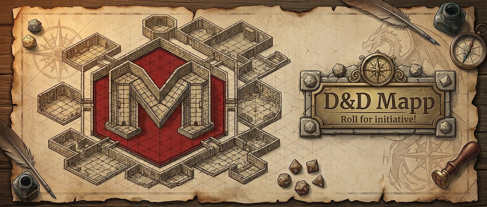

D&D Mapp is an open-source web app for dungeon masters and players of Dungeons & Dragons 5th edition. It covers the 2014 rules from the System Reference Document 5.1, and users add their own homebrew content on top.

> [!IMPORTANT]
> D&D Mapp is in early development, and none of its features exist yet.

## Get involved

- [`dnd-mapp/dnd-mapp`](https://github.com/dnd-mapp/dnd-mapp) holds the web app and the features planned for it.
- [Support](https://github.com/dnd-mapp/dnd-mapp/blob/main/SUPPORT.md) lists where questions, ideas, and bug reports go.
- [Contributing](https://github.com/dnd-mapp/dnd-mapp/blob/main/CONTRIBUTING.md) explains how to contribute code and docs.
